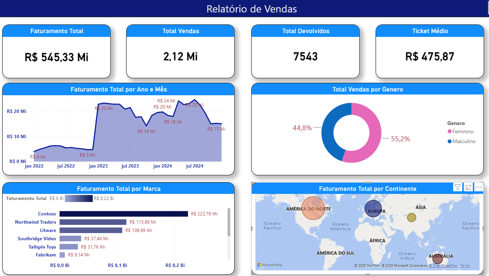
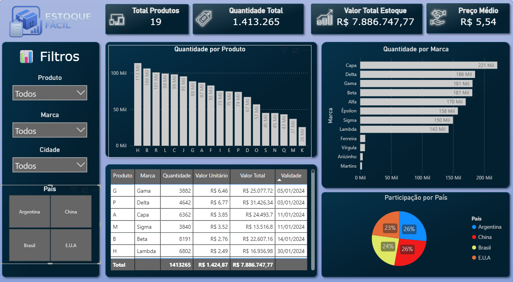

# Portfólio Power BI
Leonardo Moraes Macedo

Projetos de dashboards para visualização e análise de indicadores de vendas e estoque.

## Relatório de vendas

Dashboard que reúne indicadores de faturamento total, vendas, devoluções e ticket médio.

As visualizações permitem acompanhar a evolução mensal do faturamento e sua distribuição por marca e continente, além da distribuição das vendas por gênero.

**Ferramenta utilizada:** Power BI.

## Estoque Fácil

Dashboard para consulta e análise da composição do estoque, com indicadores de total de produtos, quantidade total, valor em estoque e preço médio.

Inclui gráficos por produto e marca, participação por país, tabela de detalhamento e filtros por produto, marca, cidade e país.

**Ferramenta utilizada:** Power BI.

## Contato

E-mail: leomacedo19@gmail.com

GitHub: https://github.com/leomacedo2
